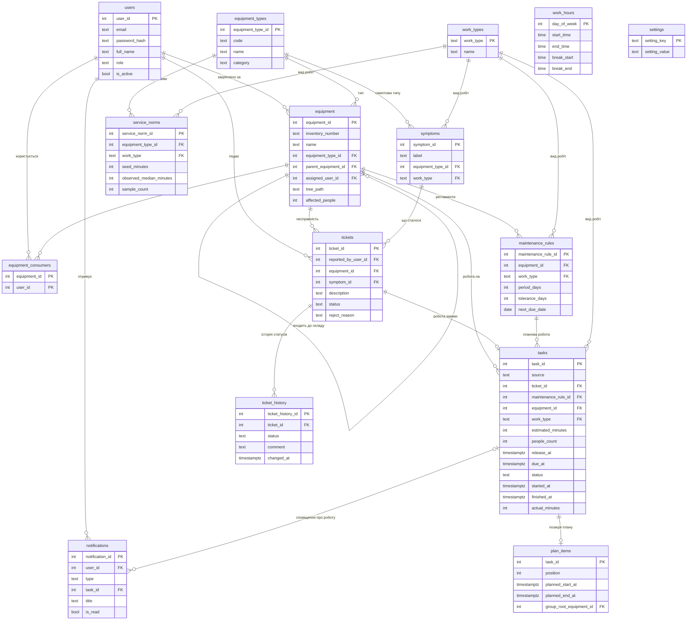

# ER-діаграма бази даних

Схема — міграції `001_schema.sql` і `003_work_types_and_fk.sql`: 15 таблиць, лише ключі,
обмеження й індекси. Тригерів і збережених функцій немає: шлях у дереві обладнання, кількість
людей, норматив тривалості й медіану нормативів рахує код сервера.

## Уся схема

## Позначення задачі планування в таблиці `tasks`

| Символ | Сенс | Колонка |
|---|---|---|
| r | момент надходження (для планової роботи — початок вікна) | `release_at` |
| d | кінець вікна планової роботи | `due_at` |
| p | тривалість за нормативом | `estimated_minutes` |
| n | кількість людей, яких зачіпає робота | `people_count` |
| C | момент завершення | `finished_at` (факт), `plan_items.planned_end_at` (план) |

## Значення текстових колонок

| Колонка | Значення |
|---|---|
| `users.role` | `EMPLOYEE`, `IT_ADMIN` |
| `*.work_type` | зовнішній ключ на довідник `work_types`; у демо-даних `DIAGNOSTICS`, `REPAIR`, `REPLACEMENT`, `MAINTENANCE`, `CLEANING`, `SOFTWARE`, адміністратор може додати інші |
| `tickets.status` | `NEW`, `SCHEDULED`, `IN_PROGRESS`, `DONE`, `REJECTED` |
| `tasks.source` | `TICKET`, `PLANNED` |
| `tasks.status` | `NEW`, `SCHEDULED`, `IN_PROGRESS`, `DONE`, `CANCELLED` |
| `notifications.type` | `TICKET`, `MAINTENANCE_PLANNED`, `MAINTENANCE_SOON` |
| `settings.setting_key` | `ALGORITHM`, `NORM_MIN_SAMPLES`, `PLAN_HORIZON_DAYS`, `REMINDER_DAYS` |
