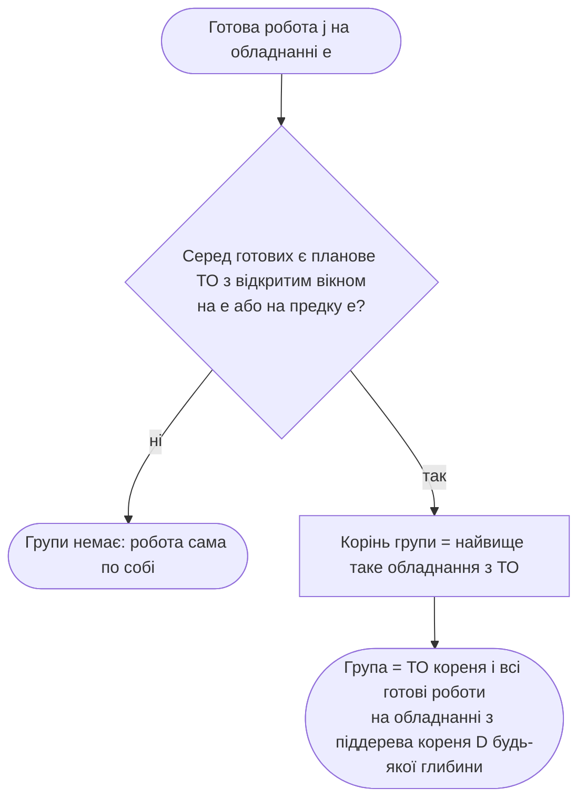

# Блок-схема функції планування

Схема описує логіку **живого плану**, побудованого крок за кроком функцією
`nextStep` (`backend/src/scheduling/planner.js`), **групи за ієрархією обладнання**
(`grouping.js`) і **призупинення роботи на обід і кінець зміни** (`calendar.js`,
`addWorkingMinutes`). Та сама функція будує план на сьогодні (`buildSchedule`;
`replanToday()` — на початку зміни, після «Почати», «Готово» і виправлення роботи)
і рухає симулятор експерименту (`runHorizon`).

## Побудова плану дня

Актуальна блок-схема `buildSchedule()` і `nextStep()` — рисунок 5.4:
`docs/thesis-diagrams/08-planning-flowchart-v2.png` (вихідні файли `08a-buildSchedule.mmd`
і `08b-nextStep.mmd`).

## Як визначається група роботи

Межа робочого дня закриває будь-яку групу (Уточнення У-1): роботу групи, яку
призупинив кінець зміни, наступного ранку доробляють першою, бо розпочату роботу
не переривають, але решта групи вже не має переваги й обирається за правилом.
